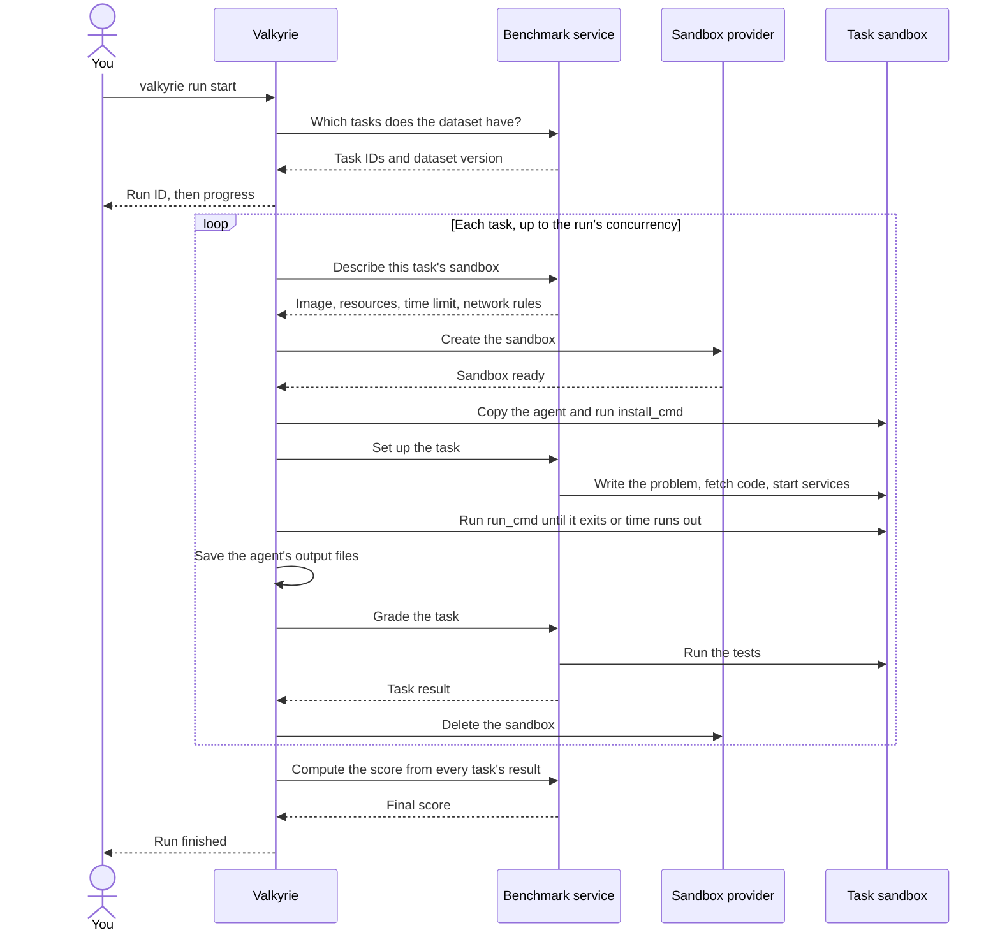

Valkyrie is a platform for evaluating AI agents on agentic benchmarks, such as SWE-bench
Verified and Terminal-Bench 2.0. One command runs a benchmark's tasks in parallel, each in
its own cloud sandbox. Valkyrie keeps every run's score, logs, and agent output, together
with the settings that produced them.

The benchmark, the agent, and the platform are separate pieces. Benchmark authors host
their benchmark as a service, and agent authors describe their agent in one
`contract.yaml`. You start and follow runs from the `valkyrie` CLI or the Python SDK, with
no benchmark to install yourself.

<CardGroup cols={2}>

<Card title="Run your first benchmark" icon="rocket" href="/get-started/quickstart">
Install the CLI, sign in, and run a test agent on one task.
</Card>

<Card title="Package an agent" icon="file-code" href="/agents/package-an-agent">
Tell Valkyrie how to install and run your agent.
</Card>

<Card title="Build a benchmark service" icon="flask-conical" href="/benchmarks/convert-a-benchmark">
Wrap an existing dataset and grader so Valkyrie can run it.
</Card>

<Card title="Use the Python SDK" icon="code" href="/sdk/quickstart">
Start and inspect runs from Python.
</Card>

</CardGroup>

## Why agents need different evaluation infrastructure

Older benchmarks such as HumanEval check a function's output against fixed tests, which
takes little more than one machine. Agentic benchmarks evaluate what an agent does inside an
environment. Each task needs its own sandbox with the right repository and tools, the agent
works in it for minutes or hours, and a test harness grades what it left behind. Run the
usual way, from one repository on one large machine, that causes four problems:

- **Benchmarks change slowly and silently.** When every benchmark lives in one repository, a
  new benchmark waits for maintainers to review it, and every user has to pull and
  reconfigure. Two people can run different versions without noticing.
- **One machine caps the run.** A machine sized for the largest run sits idle between runs,
  and still can't run hundreds of tasks at once. Logs and agent outputs stay on its disk,
  where they're hard to share and easy to lose.
- **Results rest on trust.** A submitter runs the agent on their own machine and sends in
  its outputs. A maintainer can grade the outputs again, but can't tell whether time limits
  or network rules were followed while the agent worked.
- **Agents are written against each harness.** Harnesses ask an agent to implement their
  classes or function signatures, although all that differs between agents is how to
  install and run them, where their output goes, and which secrets they need.

## How Valkyrie divides the work

Valkyrie splits an evaluation into three parts, each owned by someone different:

| Part | Owner | What it is |
| --- | --- | --- |
| Benchmark service | The benchmark's author | A web service that lists the benchmark's tasks, sets each task up in a sandbox, grades the agent's work, and computes the run's score. |
| Agent | The agent's author | The agent's code plus a `contract.yaml` that says how to install and run it, kept in an organization's agent library. |
| Platform | Vals AI, or you on a [local Tracker](/self-hosting/local-tracker) | The Tracker, which the CLI and SDK talk to, the workers that run tasks, and the storage for results. |

Because the parts are separate, each person works on their own:

- **Benchmark authors** ship a new benchmark or a fix by deploying their service. Everyone's
  next run uses it, with no change to Valkyrie and nothing for users to update. Authors
  start from a generated project, and a service can require credentials, so one service
  can serve public and private datasets. See
  [Convert a benchmark into a service](/benchmarks/convert-a-benchmark).
- **Agent authors** write a contract instead of code against Valkyrie. Any agent that
  starts from a shell command works. See [Package an agent](/agents/package-an-agent).
- **People running evaluations** install only the CLI. They keep no local copy of a
  benchmark and nothing in sync.

## A run, step by step



1. You start a run. Valkyrie asks the benchmark service which tasks the dataset has, and
   records the dataset version when the service publishes one.
2. For each task, up to the run's concurrency, Valkyrie asks the service what sandbox the
   task needs: its image, CPU, memory, and GPUs, the agent's time limit, and what each stage
   can reach on the network.
3. Valkyrie creates the sandbox with your organization's sandbox provider, copies your agent
   into it, and runs its `install_cmd`. Some benchmarks set the task up first.
4. The benchmark service sets the task up in the sandbox: it writes the problem statement,
   fetches the repository, and starts any services the task needs.
5. Valkyrie runs your agent's `run_cmd` and stops it when it exits or its
   [time limit](/runs/time-limits) runs out. Then it saves the files your agent wrote.
6. The benchmark service grades the agent's work in the same sandbox, and Valkyrie deletes
   the sandbox.
7. When every task has finished, the service turns the task results into the run's score.

Each task's log streams to the run as it goes, including the benchmark's setup and grading
messages. [Monitor runs](/runs/monitor) shows how to follow it.

## What a run guarantees

- **Everyone runs the same benchmark.** Runs on a hosted benchmark all use its one service,
  and each run records the dataset version it used, when the service publishes versions.
- **A run keeps its agent.** Agents live in your organization's library, so teammates run
  the same version. A run keeps the agent it started with: uploading a new version doesn't
  change it, unless you rerun with [`--update-agent`](/runs/manage#resume-or-retry) to pick
  up the new files.
- **Limits are applied, not trusted.** Valkyrie stops the agent when its time limit runs
  out, and sets each stage's network rules on the sandbox itself. The settings a run started
  with are stored with it.
- **Nothing lives on one machine.** Logs, agent outputs, and results are kept in your
  organization's storage, where any member can read, compare, and score them again.
- **Routine upgrades don't interrupt runs.** When a new version of Valkyrie is deployed,
  tasks that are already running finish on the version they started with. An upgrade that
  needs maintenance stops running tasks instead, and you can resume the run afterwards.

## How far it scales

Sandboxes exist only while their task runs, so nothing sits idle between runs. How many
tasks run at once is set by the run's `--concurrency`, your sandbox provider's quota, and
your model provider's rate limits. With enough of each, all 500 SWE-bench Verified tasks can
run at once, and the run takes about as long as its slowest task.

## Core concepts

- **Run:** one agent evaluated on one benchmark dataset. A run is made of tasks.
- **Task:** one problem from the dataset, run in its own sandbox.
- **Sandbox provider:** the service that creates sandboxes, such as Daytona or Modal. Runs
  use your organization's own provider account.
- **Organization:** the owner of runs, agents, and secrets. Members of an organization see
  its runs.

## Where Valkyrie runs

- **Hosted by Vals AI.** This is the default: `valkyrie login` signs you in, and Vals AI runs
  the Tracker and stores your organization's results. Sandboxes run on your own provider
  account. To get access, send an email to [contact@vals.ai](mailto:contact@vals.ai).
- **On your machine.** Run the Tracker yourself with no AWS account. See
  [Run Tracker locally](/self-hosting/local-tracker).

## Paper

Valkyrie is described in
[Valkyrie: A Microservice-Based Framework for Scalable Evaluation of AI Agents](https://doi.org/10.1145/3786335.3813231)
(CAIS '26). A reading copy is on [alphaXiv](https://www.alphaxiv.org/abs/valkyrie).

The paper ran four agents on SWE-bench Verified and Terminal-Bench 2.0 through Valkyrie, with
the same sandbox settings for every run and no per-run setup. Their accuracy is consistent
with the scores on each benchmark's public leaderboard:

| Agent | SWE-bench Verified | Terminal-Bench 2.0 |
| --- | --- | --- |
| SWE-agent (Claude Sonnet 4.6) | 77.6% | 56.17% |
| mini-SWE-agent (Claude Sonnet 4.6) | 76.2% | 61.79% |
| Claude Code (Claude Sonnet 4.6) | 51.4% | 57.3% |
| Codex CLI (GPT-5.3-Codex) | 66.0% | 66.29% |

```bibtex
@inproceedings{forzano2026valkyrie,
  author    = {Forzano, Jarett and Almatov, Omar and Nashold, Langston and Ravi, Nikil and Kassian, Orestes},
  title     = {Valkyrie: A Microservice-Based Framework for Scalable Evaluation of AI Agents},
  booktitle = {Proceedings of the 1st ACM Conference on Agentic and AI Systems},
  series    = {CAIS '26},
  year      = {2026},
  month     = {may},
  address   = {San Jose, CA, USA},
  publisher = {ACM},
  doi       = {10.1145/3786335.3813231},
  url       = {https://doi.org/10.1145/3786335.3813231}
}
```
